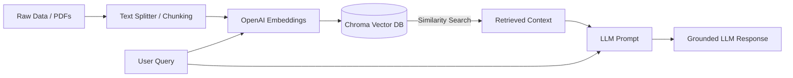

# Retrieval-Augmented Generation (RAG) with LangChain, ChromaDB & OpenAI

A practical, hands-on repository demonstrating the end-to-end concepts and implementation of **Retrieval-Augmented Generation (RAG)** using Python, LangChain, Chroma vector database, and OpenAI models.

---

## 📌 Overview

This project walks through the complete RAG lifecycle across three progressive Jupyter notebooks:

1. **Foundations**: Building a complete RAG system from scratch using custom in-memory text.
2. **Document Ingestion**: Parsing external PDF files, chunking, embedding, and persisting into a local Chroma vector database.
3. **Incremental Ingestion**: Appending new document embeddings into an existing vector store and querying unified multi-document knowledge.

---

## 🏗️ Architecture & Workflow



1. **Document Loading**: Extract text from unstructured data and PDFs using `PyMuPDFLoader`.
2. **Text Chunking**: Segment large documents into smaller, overlapping chunks using `RecursiveCharacterTextSplitter`.
3. **Embedding Generation**: Convert text chunks into high-dimensional vector representations using `text-embedding-3-small`.
4. **Vector Storage**: Index embeddings locally in a persistent `Chroma` database.
5. **Semantic Retrieval**: Fetch the top-$k$ most relevant context chunks for a user query via similarity search.
6. **Augmented Generation**: Feed the retrieved context along with the query to `ChatOpenAI` to generate accurate, hallucination-free answers.

---

## 📂 Repository Structure

```text
├── 1.0_RAG_own_words.ipynb          # Step-by-step RAG basics using custom raw text
├── 2.0_RDR_2_RAG.ipynb              # PDF ingestion, chunking, and persistent VectorDB creation
├── 3.0 RDR_add_more_data.ipynb      # Incremental data addition to existing Chroma store
├── rdr details.pdf                  # Sample PDF data used for incremental testing
├── requirements.txt                 # Project dependencies
├── .env.example                     # Template for environment variables (API keys)
├── .gitignore                       # Ignored files (secrets, venv, vector stores, large files)
└── README.md                        # Documentation
```

---

## 📓 Notebook Breakdown

### 1. `1.0_RAG_own_words.ipynb` (Foundational RAG)
- Uses custom text narrative (God of War storyline) as the knowledge base.
- Demonstrates character-based recursive chunking.
- Generates embeddings with OpenAI `text-embedding-3-small`.
- Performs similarity search and prompts `ChatOpenAI` with retrieved context.

### 2. `2.0_RDR_2_RAG.ipynb` (PDF Ingestion & Storage)
- Loads external PDF documents using `PyMuPDFLoader`.
- Splits multi-page documents into optimized chunks with overlap to preserve semantic context.
- Stores vector embeddings on disk in `./VectorDB/` using ChromaDB for persistent retrieval.
- Evaluates similarity search results against specific domain questions.

### 3. `3.0 RDR_add_more_data.ipynb` (Incremental Knowledge Ingestion)
- Connects to an existing `./VectorDB/` storage without wiping previously indexed data.
- Loads, splits, and embeds supplemental documents (`rdr details.pdf`).
- Appends new vectors to the existing collection and executes cross-document retrieval.

---

## 🚀 Getting Started

### 1. Prerequisites
- Python 3.10 or higher
- An OpenAI API Key ([Get one here](https://platform.openai.com/api-keys))

### 2. Clone the Repository
```bash
git clone <YOUR_REPO_URL>
cd RAG
```

### 3. Create and Activate Virtual Environment
```bash
# Windows
python -m venv .venv
.\.venv\Scripts\activate

# macOS / Linux
python3 -m venv .venv
source .venv/bin/activate
```

### 4. Install Dependencies
```bash
pip install -r requirements.txt
```

### 5. Setup Environment Variables
Copy `.env.example` to create your local `.env` file:
```bash
# Windows (PowerShell)
Copy-Item .env.example .env

# Linux / macOS
cp .env.example .env
```

Open `.env` and paste your OpenAI API key:
```env
OPENAI_API_KEY=sk-proj-yourActualKeyHere
```

> [!IMPORTANT]
> Never commit your `.env` file to version control. The `.gitignore` file is pre-configured to keep your API key secure.

### 6. Run the Notebooks
Launch Jupyter Lab or Jupyter Notebook:
```bash
jupyter notebook
```
Open any of the `.ipynb` files to run the cells sequentially.

---

## ⚠️ Notes on Large Files & Vector Databases

- **Large PDF Guides**: Files larger than 100 MB (such as complete game strategy guides) exceed GitHub's standard upload limit. They are excluded via `.gitignore`. You can supply your own PDF files or use Git LFS if versioning large binary assets is required.
- **Local Vector Database (`VectorDB/`)**: The generated Chroma vector database contains local SQLite and binary index files. These are generated automatically upon running the notebooks and are excluded from version control to keep the repository lightweight and clean.

---

## 📄 License

This project is licensed under the [MIT License](LICENSE).

